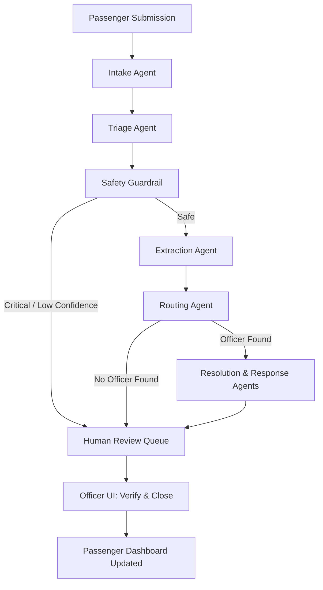
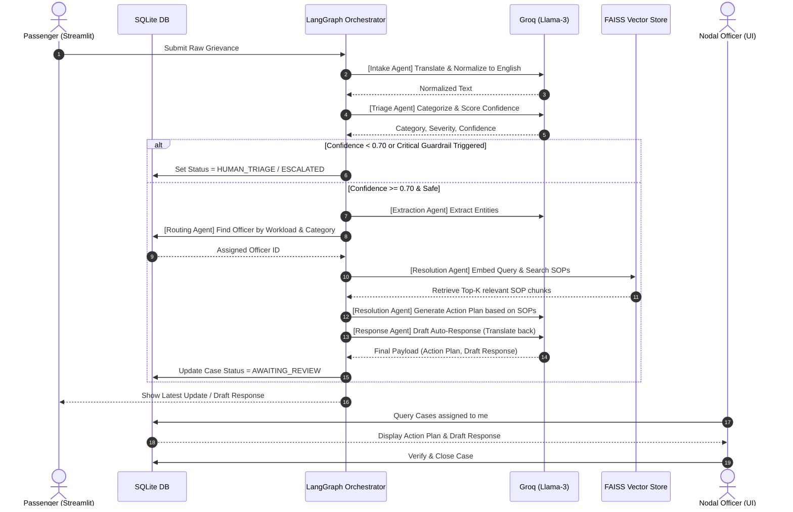

# Chennai Metro Agentic AI Prototype

A robust, multilingual, agentic Help & Grievance management system designed for the Chennai Metro Rail Limited (CMRL). This prototype uses a network of autonomous AI agents to intake, triage, route, and resolve passenger complaints in real-time.

---

## 🚀 Installation & Local Setup

Follow these steps to run the Chennai Metro Agentic AI Prototype on your local machine.

### Prerequisites
- Python 3.10 or higher
- A [Groq API Key](https://console.groq.com/keys) (Free tier is perfectly fine)

### 1. Clone the Repository
```bash
git clone https://github.com/your-username/chennai-metro-agentic-prototype.git
cd chennai-metro-agentic-prototype
```

### 2. Set Up Virtual Environment
```bash
python -m venv venv
# Windows:
venv\Scripts\activate
# Mac/Linux:
source venv/bin/activate
```

### 3. Install Dependencies
```bash
pip install -r requirements.txt
```

### 4. Configure Environment Variables
Create a `.env` file in the root directory and add your Groq API key:
```env
GROQ_API_KEY=gsk_your_api_key_here
GROQ_MODEL=llama-3.3-70b-versatile
```

### 5. Initialize the Database & Knowledge Base
Run the setup scripts to build the SQLite database, generate the Metro SOPs, and build the FAISS vector index:
```bash
python src/db/seed.py
python setup_sops.py
```

### 6. Run the Application
Start the Streamlit frontend. It will automatically open in your browser at `http://localhost:8501`.
```bash
streamlit run app.py
```

---

## 1. Agentic Architecture

The core intelligence of the platform is powered by **LangGraph**, which orchestrates a team of specialized AI agents. Each agent handles a specific cognitive step in the complaint lifecycle.

### The Agent Roster (6 Agents)
1. **Intake Agent**: Standardizes and normalizes the raw passenger input. Detects the source language (e.g., Tamil, Hindi, Gujarati) and translates it to English for backend processing.
2. **Triage Agent**: Classifies the complaint into a specific Metro category (e.g., *Ticketing, Station Facilities, Train Operations*) and assigns a severity level and confidence score.
3. **Safety Guardrail**: A specialized verifier that scans the complaint for critical keywords (e.g., harassment, physical injury, track trespassing). If triggered, it bypasses normal resolution and escalates the ticket directly to a human officer.
4. **Extraction Agent**: Pulls out structured entities from the text (Metro Line, Station, Train/Coach Number, Incident Time).
5. **Routing Agent**: Queries the database to find the best-suited, available Nodal Officer to handle the specific category of the complaint based on workload capacity.
6. **Resolution & Response Agents**: Uses Retrieval-Augmented Generation (RAG) to search the CMRL Standard Operating Procedures (SOPs) vector database. It creates an actionable resolution plan for the officer and drafts a response back to the passenger in their *original language*.

### Agent Workflow (LangGraph)



---

## 2. Technical Architecture

The platform follows a "Complexity in the Backend, Simplicity in the UI" philosophy, leveraging modern Agentic frameworks and robust data pipelines.

### 2.1 Core Technology Stack
* **Frontend Application**: Streamlit (Python). Implements session-based state management (`st.session_state`) for seamless UI updates and OTP verification loops without full page reloads.
* **Orchestration Layer**: LangGraph. Manages the multi-agent cyclic graph, passing a typed dictionary (`ComplaintAgentState`) between nodes, maintaining execution traces and history.
* **LLM Inference Engine**: Groq API. Utilizes Llama-3 (70B) for ultra-fast, low-latency semantic reasoning, categorization, and JSON extraction.
* **Relational Database**: SQLite via SQLAlchemy ORM. Provides persistent storage with ACID compliance.
* **Vector Database (RAG)**: In-memory FAISS (Facebook AI Similarity Search) index.
* **Embeddings Model**: HuggingFace `BAAI/bge-m3` model for generating dense vector embeddings from Markdown SOPs.

### 2.2 Database Schema (Relational)
The SQLite database contains 4 primary tables connected via foreign keys:
1. **Users Table** (`users`): Stores credentials, PBKDF2 hashed passwords, and Role-Based Access Control (RBAC) enumerations (`PASSENGER`, `OFFICER`, `ADMIN`).
2. **Complaints Table** (`complaints`): The central ledger. Tracks raw text, normalized text, extracted metadata (Line, Station, Train ID), JSON-serialized arrays (Entities, Resolution Plans), and state machine enums (Status, Category, Severity).
3. **Officers Table** (`officers`): Tracks active Metro staff, their department mapping (e.g., *Station Facilities*, *Train Operations*), and their dynamic workload capacity vs active cases.
4. **Lost & Found** (`lost_and_found`): A side-table for tracking recovered items, enabling the extraction agent to query for matching items.

### 2.3 Data Flow & Sequence Diagram
The following sequence diagram illustrates the exact lifecycle of a complaint hitting the backend infrastructure:



### 2.4 Prompt Engineering & Structured Extraction
To prevent hallucination and ensure strict schema adherence, the application uses **Structured Output Generation**. The Groq LLM is provided with Pydantic JSON schema definitions (e.g., `TriageResult`, `ResolutionPlan`). The LLM returns strict, parseable JSON which is then validated by Pydantic before moving to the next LangGraph node, ensuring the database never receives malformed data.
