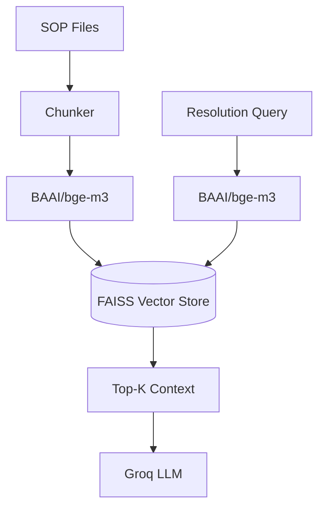

# RAG Architecture

## Purpose
Retrieval-Augmented Generation (RAG) is used to retrieve Chennai Metro Standard Operating Procedures (SOPs) to ground the AI's recommendations, preventing hallucinations.

## Data Flow
1. **Mock SOPs:** Markdown files in `data/mock_sops/`.
2. **DocumentLoader & Chunker:** Loads text and splits it into manageable chunks.
3. **Embeddings:** We use `BAAI/bge-m3` via `sentence-transformers` because it provides high-quality multilingual embeddings locally without API costs.
4. **FAISS Vector DB:** The embedded chunks are stored in a local FAISS `IndexFlatIP` (cosine similarity) index.

## Query Time (Resolution Agent)
When a complaint like "Lost backpack" arrives:
1. `retriever.py` passes the query to `bge-m3`.
2. The vector is compared in FAISS.
3. The top K (default 3) relevant chunks (e.g., `lost_found.md`) are returned.
4. These chunks are injected into the Groq prompt.

## Architectural Trade-off
For exactly five small SOP documents, a simple string search or direct mapping (e.g., if category == LOST_FOUND, read lost_found.md) would be perfectly sufficient and much faster. 
However, the RAG layer (Embeddings + FAISS) is implemented to demonstrate **production architecture scalability**. In a real deployment, the knowledge base would contain thousands of policies, emergency instructions, and manuals.

