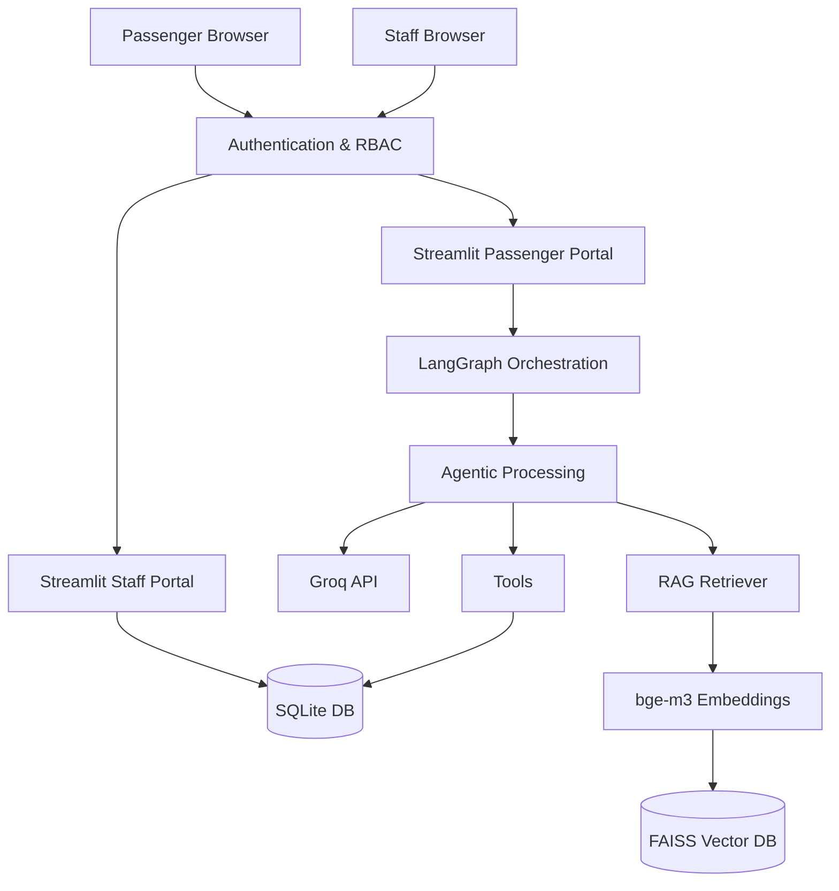

# Technical Architecture

## Local Prototype Architecture

## Production AWS Architecture

If we were to scale this for the actual Chennai Metro, the architecture would enforce strict security and access boundaries:

- **Passenger Portal:** A React Native mobile app or web frontend communicating via an API Gateway.
- **Staff Portal:** A distinct React internal web dashboard behind a VPN/Zero-Trust proxy.
- **Authentication:** AWS Cognito or Auth0, passing JWTs containing the user's role (`PASSENGER` vs `OFFICER`). These JWTs would be validated at the API Gateway, ensuring AI agents never directly handle passwords or auth tokens.
- **Orchestration:** LangGraph Cloud or AWS Step Functions orchestrating the AI pipeline asynchronously on ECS (Fargate).
- **Database:** Amazon RDS PostgreSQL, storing operational state and enforcing row-level security (so passengers can only query `WHERE user_id = :my_id`).
- **Knowledge Base:** Amazon OpenSearch Serverless replacing local FAISS for scaled vector searches over thousands of SOPs.
